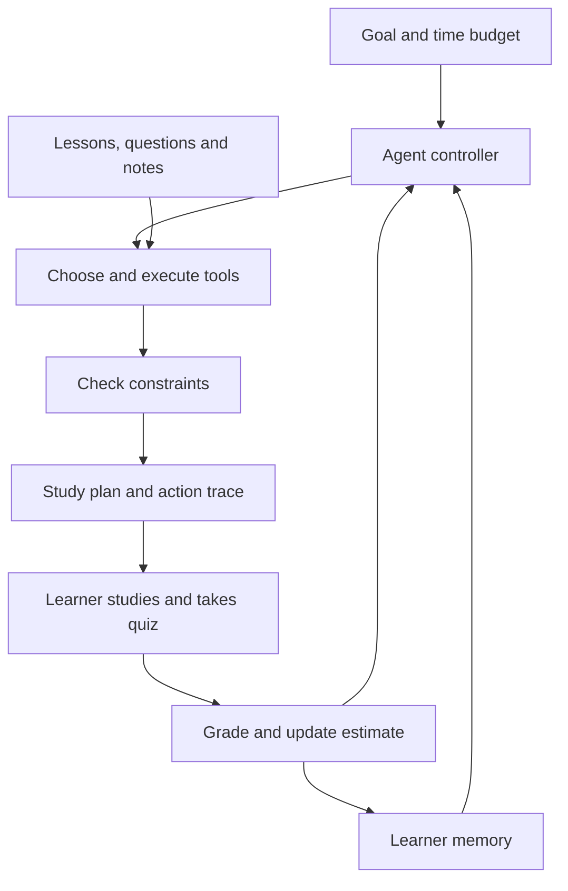
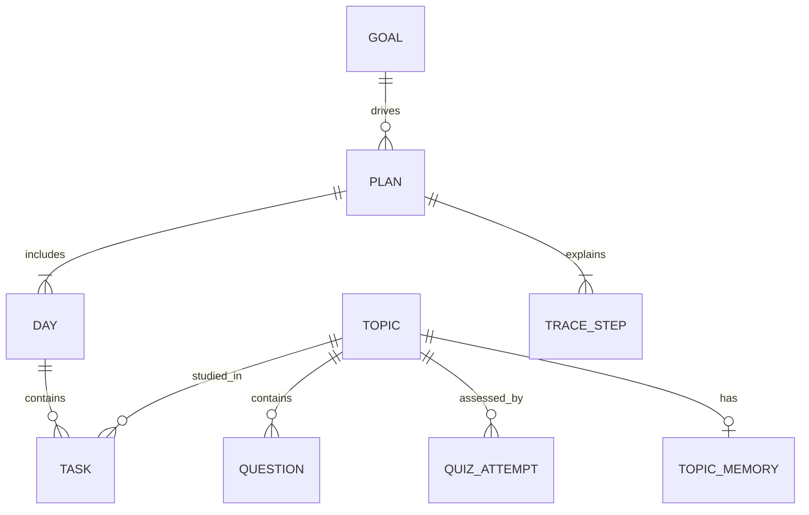
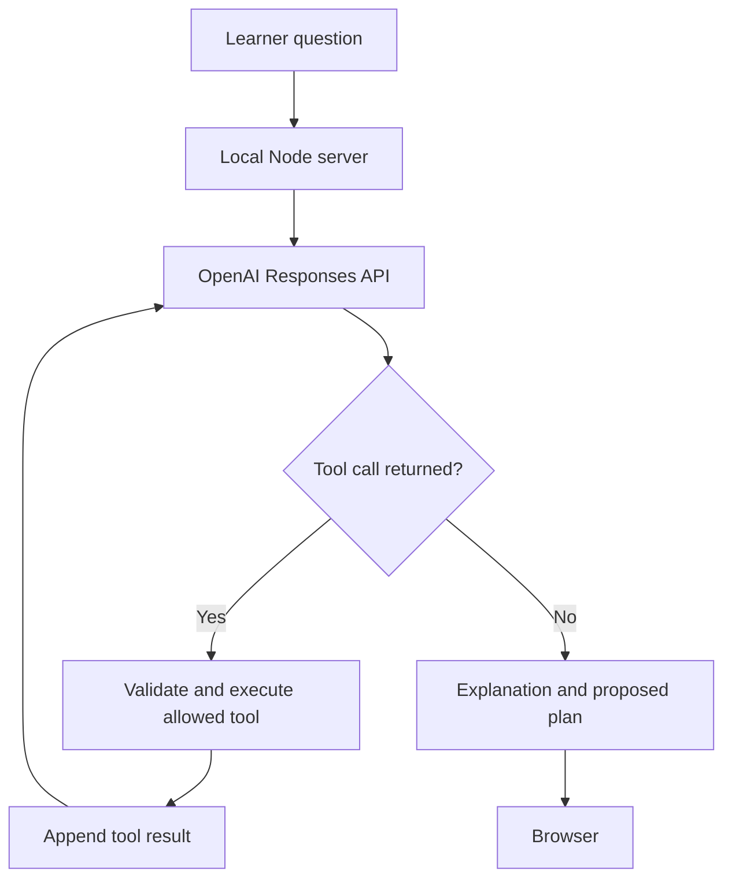

# Development schema

StudyPilot combines a goal-driven symbolic controller with executable study tools and persistent learner feedback. An optional LLM coach uses the same planner through a server-side tool interface.

## Local controller

`nextAction(state)` selects an action from the current observations. `runAgent()` executes the action, records its output and repeats until the plan is checked or the step limit is reached. Goal matching decides the scope; prerequisite dependencies constrain scheduling; feedback changes the ranking used by the next run.

| Stage | Function | Observed result |
| --- | --- | --- |
| Observe | `normalizeGoal`, `validMemory` | Valid task and saved learner state |
| Scope | `selectScope` | Matched topics and transitive prerequisites |
| Retrieve | `retrieve` | TF-IDF-style keyword scores and source-labelled excerpts |
| Prioritize | `rankTopics` | Gap, goal relevance and review-age scores |
| Plan | `buildPlan` | Day/task allocation and explicit deferred topics |
| Evaluate | `auditPlan` | Daily time limits and prerequisite order |
| Feedback | `gradeQuiz` | Correctness, explanations and updated estimates |
| Repeat | `runAgent` after quiz | A revised plan using the new state |

Priority is `3 * (1 - mastery) + 2 * goal_match + overdue_bonus`. An untested topic has a planning prior of 0.35. `goal_match` is 0 or 1; `overdue_bonus` is 0.5 when the most recent quiz is at least 3 days old. Dependencies take precedence over rank. Scores are explanatory heuristics, not a learned policy or validated probability of mastery.

The first measured estimate equals the quiz score. Subsequent estimates equal `0.7 * current_score + 0.3 * previous_estimate`. A value of at least 0.8 selects a shorter review session. Scheduling a lesson does not imply the learner mastered it.

## Data relationships

This is a logical schema. Persistence uses browser `localStorage`, not SQL. A topic also stores prerequisite topic IDs. Notes are a single plain-text string. Quiz history is capped at 100 attempts.

## Optional LLM path

Tools are `lookup_lessons`, `inspect_progress`, and `create_study_plan`. Tool schemas reject additional properties, server code checks arguments, and unknown tools are rejected. The model never executes arbitrary code. Tool outputs and any returned reasoning items are retained in the model conversation; the UI displays action outcomes, not private chain of thought.

## Execution and security bounds

- Local policy: maximum 8 controller steps.
- Optional model: maximum 5 rounds, 8 tool calls, and 90 seconds overall.
- Coach API: local host binding, same-origin checks, 64 KiB body limit, and 6 requests per minute per server process.
- API key: environment variable on the server, never in committed source or browser storage.
- User text: escaped before insertion into HTML; model text is rendered with `textContent`.
- No external actions such as email, file deletion or purchases are exposed to either controller.

## Deployment boundaries

The static `dist/` app provides the complete symbolic agent. The optional Node server runs locally and adds the model endpoint. GitHub hosts the source and schema. The Sites deployment is a separate private live app; it is not a GitHub Pages deployment. Publishing the repository alone does not enable GitHub Pages or deploy the Node server.
